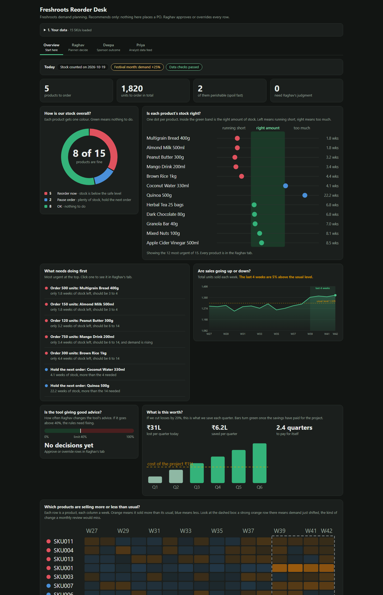

# Freshroots Reorder Desk

A demand-planning tool for a (fictional) FMCG company, built for the MESA AI-Native case *Deepa's 90-Day Mandate*.

**Live demo:** https://freshroots-reorder-desk-rust.vercel.app



## The problem

Freshroots plans demand once a month, by hand, in Excel. By the time procurement sees the forecast the data is 3-4 weeks old, and stockouts plus perishable write-offs cost ₹28-34 lakh a quarter. The planner, Raghav, documented five rules that govern about 80-85% of his recommendations:

1. Last 4 weeks more than 20% above the 12-week average: high demand, reorder 1.5x the standard quantity.
2. Stock below 6 weeks of average sales: stockout risk, reorder now.
3. Stock above 14 weeks of average sales: overstock, pause the next order.
4. Festival months (Oct, Nov, Mar): +25% demand before any check.
5. Perishable SKUs: keep 3 to 4 weeks of stock.

## What this is

The five rules as code, not AI, so Raghav can run them twice a week instead of once a month. It **recommends**; Raghav approves or overrides every row. The rules never place an order.

- **Overview**: plain-English dashboard of what needs doing first.
- **Raghav**: approve or override each SKU. Every approved order becomes a **draft purchase order** for Zoho (a dry run until Zoho is connected).
- **Deepa**: override rate against the 40% kill criterion, and ROI against the baseline.
- **Priya**: data checks before each run (missing SKUs, stale stock, duplicates).

Why Demand Planning first, out of the case's three areas: it passes all nine "does this deserve to be built" checks (real cost, repeated workflow, inputs exist). Distributor Service has no query data; Operations Intelligence fails the sizing and ownership checks.

## Run it

It is one static page, `app.html`. Open it in a browser, or serve the folder:

```bash
python -m http.server 8123
# http://localhost:8123/app.html
```

Drop your own four CSVs on the page (weekly sales, SKU master, current inventory, calendar), or use the sample data in `data/`.

`app.html` is generated. Edit `app.template.html`, then:

```bash
python build_app.py
```

## Tests

```bash
python test_recommend.py   # the rules, in Python
node check_parity.cjs      # the page's JavaScript gives the same answers as the Python; data checks; Supabase and Zoho request shapes
```

## Cloud sync and Zoho (optional)

The page can save decisions to your own Supabase project and load SKU data from it. See `supabase/README.md`: run `schema.sql`, `seed.sql`, `po.sql`, then paste your project URL and **publishable** key into the page. Never use the secret key.

The Zoho purchase-order step is **not connected**. `supabase/functions/create-po` is a draft that has not been run against a real Zoho account.

## Diagrams

`system-map.html` has the components map and the workflow.

## Notes

- The sample data is the case's, not real Freshroots data.
- The access policies in the SQL let anyone holding the publishable key read and write the decision tables. Fine for a pilot; add Supabase Auth before wider use.
- No unit costs, supplier lead times or open Zoho orders are in the data, so the tool cannot see orders already in transit.
